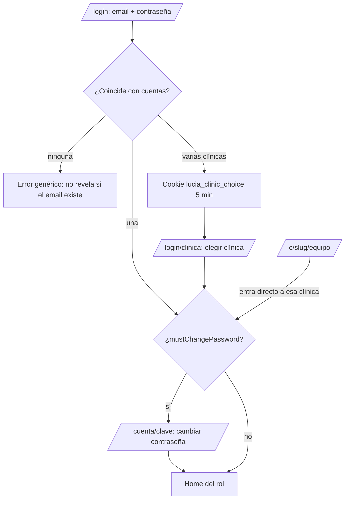
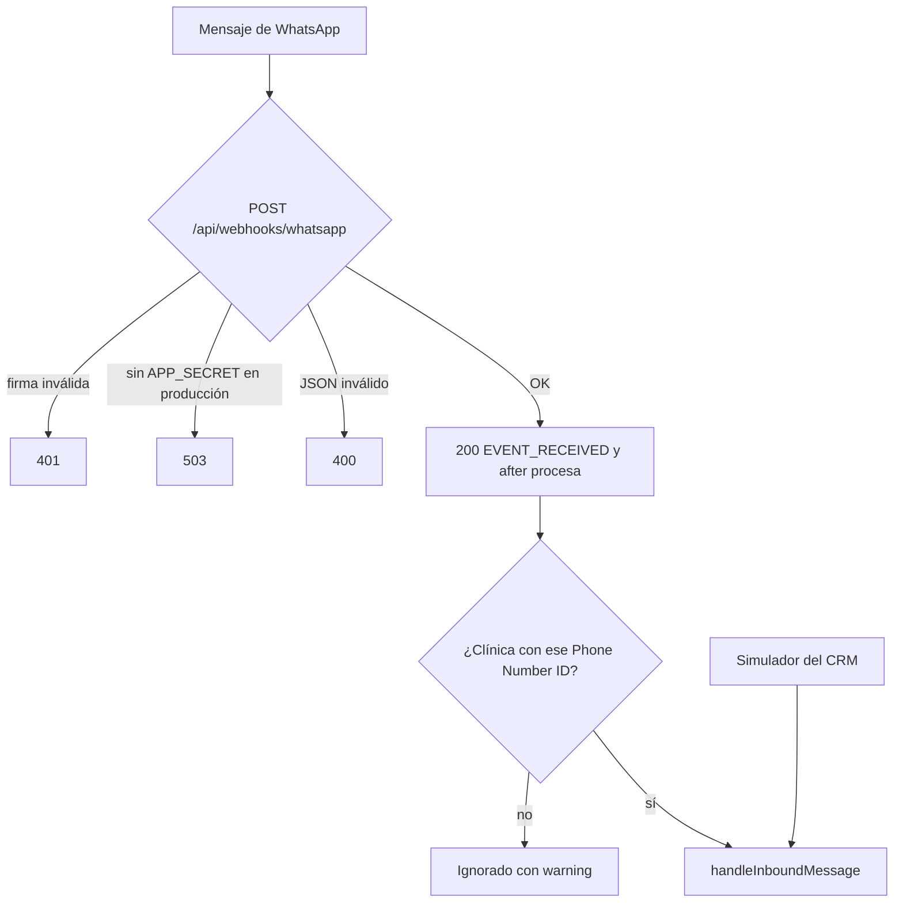
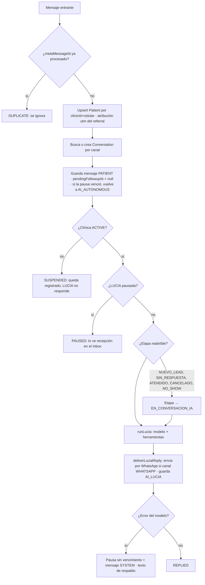
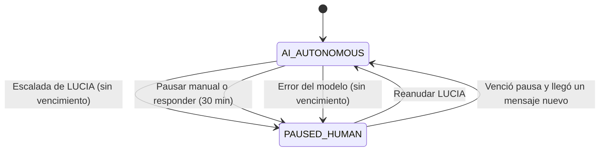
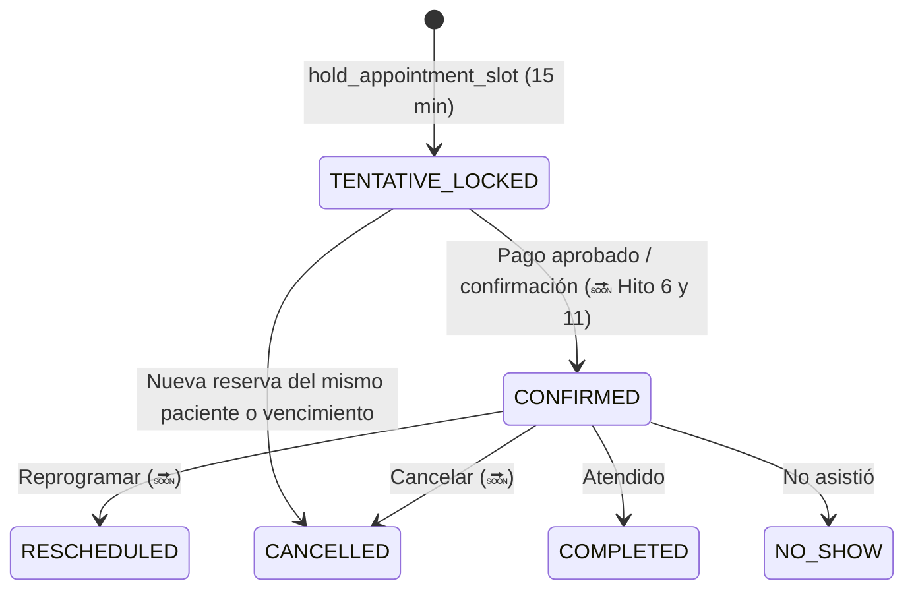

# Mapa de flujos — LUCIA CRM

> Todos los flujos y casos de la aplicación, por actor. Cada flujo lleva su estado:
> ✅ implementado (hasta Hito 4) · 🔜 planificado (Hito indicado, ver `docs/specs/05`) · ⚠️ pendiente de definir.
> Fuentes: `src/` (código), `docs/specs/01_prd.md` (requisitos), `HISTORY.md`. Actualizar al cerrar cada hito.

## Índice
1. [Actores y accesos](#1-actores-y-accesos)
2. [Ingreso y sesión](#2-ingreso-y-sesión)
3. [Plataforma (equipo LUCIA)](#3-plataforma-equipo-lucia)
4. [Administración de la clínica](#4-administración-de-la-clínica)
5. [Conversación con LUCIA](#5-conversación-con-lucia-whatsapp-y-simulador)
6. [Inbox e intervención humana](#6-inbox-e-intervención-humana)
7. [Pipeline (Kanban)](#7-pipeline-kanban)
8. [Turnos: ciclo de vida](#8-turnos-ciclo-de-vida)
9. [Agenda y pacientes (médico / admin)](#9-agenda-y-pacientes)
10. [Marketing](#10-marketing)
11. [Flujos futuros](#11-flujos-futuros)
12. [Casos borde y reglas transversales](#12-casos-borde-y-reglas-transversales)

---

## 1. Actores y accesos

| Actor | Alta | Secciones (`src/lib/auth/roles.ts`) | Restricciones de datos |
| :--- | :--- | :--- | :--- |
| **Paciente / contacto** (externo) | Escribe por WhatsApp | Sólo conversa (WhatsApp). Web: 🔜 Hito 7 | — |
| **Plataforma** (`PLATFORM_ADMIN`) | Seed | `/plataforma` | Sin acceso a pacientes ni datos clínicos |
| **Administrador** (`ADMIN`) | Lo crea Plataforma (1.º) o otro Admin | Pipeline, Inbox, Simulador, Agenda, Pacientes, Marketing, Configuración | Sólo su clínica |
| **Secretaría** (`SECRETARIA`) | Admin | Pipeline, Inbox, Simulador | No ve `reason` (motivo de consulta) |
| **Médico** (`MEDICO`) | Admin | Agenda, Pacientes | Sólo pacientes con turno suyo |
| **Marketing** (`MARKETING`) | Admin | Marketing | Sólo agregados, sin nombres |
| **LUCIA** (agente IA) | — | Webhook / simulador | Herramientas reciben paciente y conversación por contexto, nunca del modelo |
| **Meta WhatsApp Cloud** (sistema) | — | `POST /api/webhooks/whatsapp` | Firma HMAC verificada |

Doble chequeo de acceso: `src/proxy.ts` (optimista, por cookie) + `requireClinicUser` / `requirePlatformUser` en cada página y server action.

---

## 2. Ingreso y sesión



| Caso | Resultado | Estado |
| :--- | :--- | :--- |
| Credenciales válidas, una cuenta | Cookie `lucia_session` (JWT HS256) → home del rol (primera sección permitida) | ✅ |
| Mismo email+clave en varias clínicas (ej. Dr. Rossi) | Elige clínica; sólo se listan las que coincidieron | ✅ |
| Credenciales inválidas | Mensaje genérico | ✅ |
| Contraseña inicial / reseteada | `mustChangePassword` → fuerza `/cuenta/clave` | ✅ |
| Clínica suspendida | Sin sesión (no puede ingresar) | ✅ |
| Usuario desactivado, rol o clínica cambiados | La sesión se invalida; vuelve a `/login` | ✅ |
| Rol sin permiso a una ruta | Redirige al home de su rol | ✅ |
| Sin sesión en ruta protegida | Redirige a `/login` | ✅ |
| `/` | Redirige al home del rol | ✅ |
| Cerrar sesión (y cambiar de clínica) | Logout y nuevo ingreso | ✅ |
| `/c/<slug>/equipo` | Login directo de una clínica | ✅ |
| `/c/<slug>` página pública para pacientes | 🔜 Hito 7 | 🔜 |

Home por rol: Admin y Secretaría → `/pipeline`; Médico → `/agenda`; Marketing → `/marketing`; Plataforma → `/plataforma`.

---

## 3. Plataforma (equipo LUCIA)

| Flujo | Detalle | Estado |
| :--- | :--- | :--- |
| Alta de clínica | Nombre, CUIT (`NN-NNNNNNNN-N`), slug único, teléfono, 1.ª sede (nombre y dirección), nombre y email del 1.er Admin. Crea clínica + sede + Admin con contraseña inicial **mostrada una sola vez** | ✅ |
| Alta con slug/email duplicado | Error de validación | ✅ |
| Suspender clínica | Sus usuarios no ingresan; LUCIA no responde (el mensaje igual se registra) | ✅ |
| Reactivar clínica | Vuelve a operar | ✅ |
| Ver métricas operativas | Usuarios, sedes, pacientes, conversaciones del mes por clínica; **nunca datos de pacientes** | ✅ |

---

## 4. Administración de la clínica

Sección **Configuración** (`/admin`, sólo `ADMIN`).

| Flujo | Detalle | Estado |
| :--- | :--- | :--- |
| Editar datos de la clínica | `updateClinic` | ✅ |
| Alta de sede | `/admin/sedes/nueva`: nombre, dirección, teléfono | ✅ |
| Editar / desactivar sede | `/admin/sedes/[id]`. Desactivar una sede la oculta de agenda y de LUCIA | ✅ |
| Alta de médico | `/admin/medicos/nuevo`: usuario + `DoctorProfile` (especialidad, matrícula, arancel de consulta) | ✅ |
| Editar médico y horarios | `/admin/medicos/[id]`: horario **por sede y por día**, consultorio; hoy 1 franja por día | ✅ |
| Varias franjas por día | Ej. 9–13 y 15–19, sin superponerse | 🔜 Hito 6 |
| Alta de usuario del equipo | Cualquier rol de clínica; contraseña inicial generada, se muestra una vez | ✅ |
| Activar / desactivar usuario | `setUserActive` | ✅ |
| Cambiar rol de usuario | `changeUserRole` | ✅ |
| Resetear contraseña | `resetUserPassword` → nueva clave única, fuerza cambio | ✅ |
| Email repetido | Único dentro de la clínica; permitido entre clínicas | ✅ |
| Persona en 2 clínicas | Una cuenta independiente por clínica, cada una con su clave | ✅ |
| Página web de la clínica (logo, texto, publicar) | 🔜 Hito 7 | 🔜 |
| Tabla de coberturas (obra social × plan) | 🔜 Hito 11 | 🔜 |
| Integración ARCA (certificado, punto de venta, tipo de factura) | 🔜 Hito 12 | 🔜 |
| Corte mañana/tarde configurable (13:00) | 🔜 Hito 7/8 | 🔜 |

---

## 5. Conversación con LUCIA (WhatsApp y simulador)

### 5.1 Entrada de mensajes



`GET /api/webhooks/whatsapp` = verificación de la suscripción de Meta (`hub.verify_token`).

### 5.2 `handleInboundMessage` (punto de entrada único: webhook, simulador, `scripts/chat.ts`)



Resultados posibles (`InboundOutcome`): `DUPLICATE`, `SUSPENDED`, `PAUSED`, `REPLIED`.
Entrega: sin token de WhatsApp el mensaje se guarda y la entrega queda como "no enviado: <motivo>"; en el simulador nunca se envía a Meta.

### 5.3 Intenciones y herramientas del agente

Reglas del prompt (`src/lib/agent/prompt.ts`) y herramientas (`src/lib/agent/tools.ts`):

| Intención del paciente | Qué hace LUCIA | Herramienta | Estado |
| :--- | :--- | :--- | :--- |
| **Urgencia** (dolor agudo, pérdida súbita de visión, destellos/cortina, trauma, quemadura química, cuerpo extraño) | No ofrece turnos; indica guardia o contacto prioritario. Pausa sin vencimiento, etapa `DERIVADO_HUMANO`, mensaje SYSTEM con nivel | `escalate_to_human` (`EMERGENCY`) | ✅ |
| **Pide hablar con una persona** | Deriva a recepción | `escalate_to_human` (`LOW`) | ✅ |
| **Sacar turno** | Motivo → obra social/particular → sede (si hay más de una) → disponibilidad (máx. 3 opciones) → pide nombre y apellido → reserva → pago | `check_availability` → `hold_appointment_slot` → `generate_mercadopago_payment` | ✅ (cobro simulado) |
| **Info: ubicación / sedes** | Responde con datos oficiales | `get_clinic_info(UBICACION)` | ✅ |
| **Info: obras sociales** | Lista de aceptadas + particular | `get_clinic_info(OBRAS_SOCIALES)` | ✅ |
| **Info: preparación de estudios** | Fondo de ojo, campo visual, etc. | `get_clinic_info(ESTUDIOS_PREPARACION)` | ✅ |
| **Info: precios** | Arancel particular por médico; con obra social puede ser sólo copago | `get_clinic_info(PRECIOS)` | ✅ |
| **Síntomas leves** | No da consejos de alivio ni diagnóstico; ofrece consulta (o aplica urgencia) | — (guardrail de prompt) | ✅ |
| **Preferencia de médico o día** | Filtra `check_availability` por `doctorId` / fechas | `check_availability` | ✅ |
| **Reprogramar / cancelar turno** | — | 🔜 Hito 6/8 (sin herramienta hoy) | 🔜 |
| **Datos fuera de contexto** (hospitales, "te van a llamar") | No inventa ni promete lo no ejecutado | — (guardrail) | ✅ |

### 5.4 Reserva de turno (flujo feliz y variantes)

```mermaid
sequenceDiagram
  participant P as Paciente
  participant L as LUCIA
  participant S as Scheduling
  participant CRM as CRM / Pipeline
  P->>L: Quiero turno
  L->>P: Motivo, obra social, sede
  L->>S: check_availability(sede, médico?, fechas)
  S-->>L: slots libres
  L->>P: Hasta 3 opciones numeradas
  P->>L: Elige una y da nombre/apellido
  L->>S: hold_appointment_slot (Serializable)
  S-->>L: appointmentId + lockedUntil (15 min)
  Note over CRM: etapa RESERVA_TENTATIVA
  L->>S: generate_mercadopago_payment
  Note over CRM: etapa PENDIENTE_PAGO · Payment PENDING
  L->>P: Confirma datos; sin MP real: "recepción te envía el link"
```

| Caso | Comportamiento | Estado |
| :--- | :--- | :--- |
| Sin disponibilidad en el rango | LUCIA lo informa y propone ampliar fechas/sedes | ✅ |
| Slot tomado entre oferta y reserva | `SLOT_NOT_AVAILABLE` → "ya no está disponible", vuelve a consultar | ✅ |
| Doble booking concurrente | Transacción `Serializable`; sólo uno gana | ✅ |
| Médico inexistente / de otra clínica | Error `DOCTOR_NOT_FOUND` | ✅ |
| Fecha con formato inválido o rango > 14 días | Validación / tope `MAX_RANGE_DAYS` | ✅ |
| Turnos con menos de 60 min de anticipación | No se ofrecen (`MIN_LEAD_MINUTES`) | ✅ |
| El paciente ya tenía una reserva tentativa | Se cancela la anterior al reservar una nueva | ✅ |
| Reserva vence (15 min) sin pago | El slot vuelve a estar libre (`lockedUntil` ya no bloquea) | ✅ (implícito) |
| Pago pedido con reserva vencida/inexistente | "No hay una reserva vigente": vuelve a reservar | ✅ |
| Cobro real con Mercado Pago, webhook de pago | `approved` / `rejected` / `in_process` → confirma turno | 🔜 Hito 11 |
| Hasta Hito 6 | Turno se confirma al reservar; cobro en la clínica | 🔜 Hito 6 |
| Falla el LLM / free tier 503 o 5 req/min | Texto de respaldo + pausa sin vencimiento + aviso SYSTEM | ✅ |

### 5.5 Identificación de paciente y contacto

| Caso | Comportamiento | Estado |
| :--- | :--- | :--- |
| Hoy | El celular crea/identifica al `Patient` (nombre se completa por la conversación) | ✅ (modelo previo) |
| Info sin identificar (precios, ubicación) | Sin validación | 🔜 Hito 8 |
| Reservar: preguntar **para quién** es el turno | Pide nombre, apellido, DNI y sexo de quien se atiende | 🔜 Hito 5/8 |
| Datos coinciden con paciente registrado | Valida para la conversación y asocia al contacto; no se repite en la misma conversación | 🔜 Hito 8 |
| Datos no coinciden | Mensaje fijo ("No encontramos un paciente con esos datos…") + link de registro; no revela si el DNI existe | 🔜 Hito 8 |
| Registro con DNI ya existente y otros datos | Rechaza e indica contactar recepción | 🔜 Hito 7 |
| 3 intentos fallidos por conversación y día | Deriva a recepción | 🔜 Hito 8 |
| Turno para otra persona (hijo, familiar) | Un contacto con varios pacientes | 🔜 Hito 5/8 |
| Comparación de datos | Sin mayúsculas, tildes ni espacios; DNI sin puntos | 🔜 Hito 5 |
| Registro completado mientras corre la ventana de 24 h | LUCIA retoma la reserva; email de bienvenida | 🔜 Hito 7/8 |
| Edición de datos por el contacto | Sólo pacientes que registró; no nombre/DNI/sexo | 🔜 Hito 5/7 |
| Protección | LUCIA nunca enumera pacientes/turnos de un celular ni muestra datos guardados | 🔜 Hito 8 |

### 5.6 Simulador (CRM)

`/simulador` (Admin, Secretaría): prueba a LUCIA sin WhatsApp.

| Flujo | Detalle | Estado |
| :--- | :--- | :--- |
| Iniciar simulación | Crea paciente `utmSource=simulador` con celular `+54 9 0000…` | ✅ |
| Enviar mensaje | `handleInboundMessage` con canal `SIMULATOR`; nunca va a Meta | ✅ |
| Limpiar datos del simulador | `clearSimulatorData` borra pacientes/conversaciones de prueba | ✅ |
| Aislamiento | Excluidos de Marketing | ✅ |
| Modelo | `LLM_PROVIDER=mock` (determinista) o Gemini (`LLM_MODEL=gemini-3.7-flash`) | ✅ |

---

## 6. Inbox e intervención humana

`/inbox` y `/inbox/[id]` (Admin, Secretaría).



| Caso | Resultado | Estado |
| :--- | :--- | :--- |
| Ver conversaciones y mensajes (PATIENT, AI_LUCIA, HUMAN_AGENT, SYSTEM) | Lista + detalle | ✅ |
| Operador responde | Guarda `HUMAN_AGENT`, envía por WhatsApp si canal WHATSAPP, y pausa a LUCIA `HUMAN_TAKEOVER_MINUTES` (30) | ✅ |
| Responder sin token de WhatsApp | Se guarda y avisa que no se envió | ✅ |
| Responder en conversación del simulador | Sólo se guarda | ✅ |
| Pausar LUCIA a mano | 30 min | ✅ |
| Reanudar LUCIA | `AI_AUTONOMOUS`, `pausedUntil = null` | ✅ |
| Paciente escribe durante la pausa | `PAUSED`: el mensaje se guarda, LUCIA no responde | ✅ |
| Pausa por escalada | Sin vencimiento hasta que recepción reanude | ✅ |
| Mensaje mayor a 4096 caracteres o vacío | Rechazado | ✅ |
| Conversación de otra clínica | "Conversación no encontrada" | ✅ |
| Responder fuera de la ventana de 24 h de WhatsApp | Requiere plantilla aprobada de Meta | 🔜 Hito 10 |

---

## 7. Pipeline (Kanban)

`/pipeline` (Admin, Secretaría). 8 columnas agrupan las 12 etapas (`src/lib/pipeline.ts`):

| Columna | Etapas | Al soltar una tarjeta → etapa |
| :--- | :--- | :--- |
| Nuevo contacto | `NUEVO_LEAD` | `NUEVO_LEAD` |
| Conversando con LUCIA | `EN_CONVERSACION_IA`, `DERIVADO_HUMANO`, `LEAD_PENDIENTE_RESPUESTA`, `RESERVA_TENTATIVA` | `EN_CONVERSACION_IA` |
| Pendiente de pago | `PENDIENTE_PAGO` | `PENDIENTE_PAGO` |
| Turno confirmado | `TURNO_CONFIRMADO` | `TURNO_CONFIRMADO` |
| Recordatorio 24h enviado | `RECORDATORIO_24H_ENVIADO` | igual |
| En espera / en consulta | `EN_SALA_DE_ESPERA` | igual |
| Atendido | `ATENDIDO` | igual |
| No show / cancelado | `NO_SHOW`, `CANCELADO` | `CANCELADO` |

Quién mueve las etapas hoy:

| Disparador | Transición | Estado |
| :--- | :--- | :--- |
| Llega el primer mensaje | `NUEVO_LEAD` | ✅ |
| Paciente en `NUEVO_LEAD`, `LEAD_PENDIENTE_RESPUESTA`, `ATENDIDO`, `CANCELADO` o `NO_SHOW` escribe | → `EN_CONVERSACION_IA` | ✅ |
| `hold_appointment_slot` | → `RESERVA_TENTATIVA` | ✅ |
| `generate_mercadopago_payment` | → `PENDIENTE_PAGO` | ✅ |
| `escalate_to_human` | → `DERIVADO_HUMANO` | ✅ |
| Arrastrar tarjeta (secretaría/admin) | → `dropStage` de la columna | ✅ |
| Pago aprobado / turno confirmado | → `TURNO_CONFIRMADO` | 🔜 Hito 6 / 11 |
| 24 h sin respuesta | → `LEAD_PENDIENTE_RESPUESTA` + seguimiento | 🔜 Hito 10 |
| Recordatorio 24 h enviado | → `RECORDATORIO_24H_ENVIADO` | 🔜 Hito 10 |
| Llegada a sala de espera / atención / no show | Manual hoy por drag & drop | ✅ manual · automatizar 🔜 |

Filtros por médico, sede, canal de origen y rango de fechas: parcial; por sede ✅ (`ParamPicker`).
Seguridad: `movePatientStage` valida `clinicId` del usuario; paciente de otra clínica → "Paciente no encontrado".

---

## 8. Turnos: ciclo de vida

Estados (`AppointmentStatus`): `TENTATIVE_LOCKED` → `CONFIRMED` → `COMPLETED`; alternativas `CANCELLED`, `RESCHEDULED`, `NO_SHOW`.



| Flujo | Quién | Estado |
| :--- | :--- | :--- |
| Reservar por WhatsApp (LUCIA) | Paciente | ✅ (queda tentativo; sin confirmación automática hasta Hito 6/11) |
| Crear turno manual | Secretaría / Admin | 🔜 Hito 6 |
| Reprogramar | Secretaría / Paciente (WhatsApp, web) | 🔜 Hito 6, 7, 8 |
| Cancelar | Secretaría / Paciente | 🔜 Hito 6, 7, 8 |
| Reservar por la web | Contacto | 🔜 Hito 7 |
| Confirmar tras pago / autorización de obra social | Sistema / recepción | 🔜 Hito 11 |
| Reserva tentativa de 24 h cuando la cobertura requiere autorización | Recepción confirma o rechaza | 🔜 Hito 11 |
| Notificación al reservar/cancelar/reprogramar (email + WhatsApp + `.ics`) | Sistema | 🔜 Hito 7–10 |
| Evento en Google Calendar del médico (sin motivo) | Sistema | 🔜 Hito 9 |
| Factura ARCA tras el pago | Sistema | 🔜 Hito 12 |

Disponibilidad (`src/lib/scheduling.ts`): huecos libres = franjas del médico por sede/día − turnos que bloquean (confirmados o `TENTATIVE_LOCKED` vigentes) − anticipación mínima 60 min; rango máx. 14 días.

---

## 9. Agenda y pacientes

### 9.1 Agenda (`/agenda`, Admin y Médico)

| Caso | Resultado | Estado |
| :--- | :--- | :--- |
| Médico entra | Ve **sólo su** agenda del día | ✅ |
| Admin entra | Elige médico (`?medico=`) | ✅ |
| Navegar por fecha | `?fecha=YYYY-MM-DD` (fecha inválida → hoy) | ✅ |
| Filtrar por sede | `?sede=` (sede inexistente se ignora) | ✅ |
| Día sin atención | "sin atención este día" | ✅ |
| Sin médicos en la clínica | Mensaje vacío | ✅ |
| Detalle del turno | Hora, paciente, estado, motivo (el médico lo ve) | ✅ |
| Vistas Semana, Mes y Año | Grilla / calendario / 12 meses | 🔜 Hito 6 |
| Secretaría ve la agenda (sin motivo) | 🔜 Hito 6 | 🔜 |
| Médico edita sus propias franjas por sede | 🔜 Hito 6 | 🔜 |
| Conectar Google Calendar | 🔜 Hito 9 | 🔜 |

### 9.2 Pacientes (`/pacientes`, Admin y Médico)

| Caso | Resultado | Estado |
| :--- | :--- | :--- |
| Médico: lista | Sólo pacientes con turno suyo | ✅ |
| Médico abre ficha de paciente sin turno suyo | 404 | ✅ |
| Admin: lista | Todos los de la clínica | ✅ |
| Ficha | Datos, historial de turnos, motivo de consulta | ✅ |
| Alta y edición manual por Secretaría/Admin (con DNI y sexo) | 🔜 Hito 5/6 | 🔜 |
| Separar Contacto de Paciente | 🔜 Hito 5 | 🔜 |
| Historia clínica y recetas | 🔜 Hito 13 (postergado) | 🔜 |

---

## 10. Marketing

`/marketing` (Admin, Marketing). Sólo agregados, sin nombres.

| Elemento | Detalle | Estado |
| :--- | :--- | :--- |
| KPIs | Leads, turnos, conversiones | ✅ |
| Embudo de conversión | Pacientes que alcanzaron cada etapa, % sobre leads | ✅ |
| Atribución por canal | UTM: Meta Ads (Facebook/Instagram), Google Ads, orgánico, sin atribución | ✅ |
| Atribución por anuncio | `referral` de Click-to-WhatsApp → `utmSource` / `utmCampaign` del paciente | ✅ |
| Exclusión del simulador | `utmSource=simulador` fuera de métricas | ✅ |
| Filtro por sede | | ✅ |
| Reactivados vs. perdidos | 🔜 Hito 10 | 🔜 |
| Pago completado y asistencia efectiva | 🔜 Hito 6 y 11 | 🔜 |

---

## 11. Flujos futuros

| Hito | Contenido | Flujos nuevos |
| :--- | :--- | :--- |
| **5** | Contactos y pacientes | Entidad Contacto; paciente = nombre+apellido+DNI+sexo; un contacto con varios pacientes |
| **6** | Agenda y turnos | Vistas día/semana/mes/año; turnos manuales; reprogramar/cancelar; varias franjas; turnos confirmados al reservar |
| **7** | Portal web `/c/<slug>` | Registro de pacientes; ingreso con código por email; reserva web con mañana/tarde; ver, cancelar y reprogramar; email de bienvenida |
| **8** | Identificación en WhatsApp | Validar 4 datos; link de registro; límite de 3 intentos |
| **9** | Google Calendar | OAuth del médico; crear/actualizar/borrar eventos (sentido LUCIA → Google) |
| **10** | Recordatorios | Seguimiento a 24 h sin respuesta; recordatorio 24 h con botones (Confirmar / Reprogramar / Cancelar); plantillas Meta |
| **11** | Cobros | Preferencia de Mercado Pago; webhook de pago; coberturas por obra social/plan (`SIN_CARGO`, `COPAGO`, `SENA`, `PARTICULAR`, `NO_ATIENDE`); `check_coverage` |
| **12** | ARCA | Factura B/C con CAE y QR; envío por WhatsApp |
| **13** | Opcionales | Historia clínica, recetas, reseñas de Google 2–4 h tras la consulta |

⚠️ Pendientes de definir: reintegro de seña; reglas de cobertura para estudios/prácticas; punto de venta ARCA por sede.

---

## 12. Casos borde y reglas transversales

| Tema | Regla |
| :--- | :--- |
| **Aislamiento multi-clínica** | Todas las consultas filtran por `clinicId`; recursos de otra clínica responden "no encontrado" |
| **Clínica suspendida** | Sin login; WhatsApp registra pero no responde; datos intactos |
| **PHI** | Secretaría no ve motivo; Marketing sólo agregados; Médico sólo pacientes propios; Plataforma sin acceso a pacientes |
| **Fechas** | Siempre hora Argentina (UTC-3) vía `src/lib/dates.ts`; formato 24 h |
| **Idempotencia** | Dedupe por `metaMessageId`; reservas con transacción Serializable |
| **Webhook** | Responde 200 de inmediato y procesa con `after()` para evitar reintentos de Meta; errores por mensaje no frenan al resto |
| **Datos del contacto** | El celular no identifica a un paciente (puede cambiar de dueño); el código web va sólo por email |
| **Seguridad de LUCIA** | Paciente y conversación se inyectan por contexto, nunca desde el modelo; no hay consejos médicos, ni se inventan horarios ni instituciones |
| **Contraseñas** | Generadas, mostradas una vez, cambio obligatorio; errores de login genéricos |
| **Caída del LLM** | Respuesta de respaldo + pausa sin vencimiento + mensaje SYSTEM para recepción |
| **Límites de WhatsApp** | Fuera de la ventana de 24 h sólo plantillas aprobadas |
| **Demo** | https://crm-poc1.vercel.app (LUCIA mock); smoke test `node qa/e2e/smoke-demo.mjs` |
