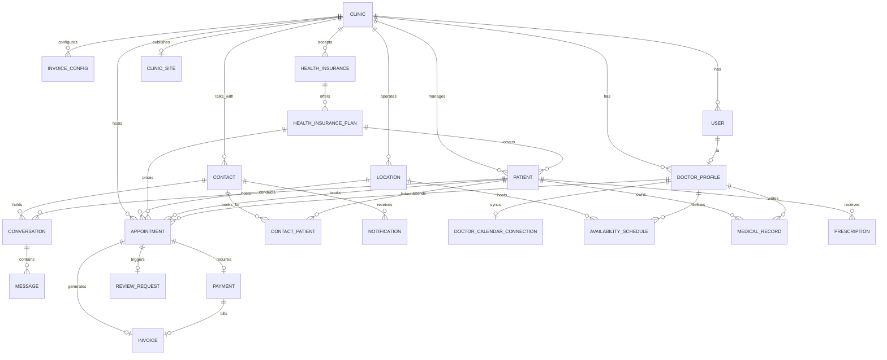

# LUCIA — Tu Recepcionista Oftalmológica Virtual con IA
## 03. Modelo de Datos y Esquema de Base de Datos (PostgreSQL / Prisma)

---

### 1. Diagrama Entidad-Relación (ERD)



---

### 2. Esquema Relacional de Referencia (Prisma Schema)

```prisma
datasource db {
  provider = "postgresql"
  url      = env("DATABASE_URL")
}

generator client {
  provider = "prisma-client-js"
}

// ----------------------------------------------------
// 1. GESTIÓN DE CLÍNICA Y USUARIOS (RBAC)
// ----------------------------------------------------

enum Role {
  ADMIN
  SECRETARIA
  MEDICO
  MARKETING
}

model Clinic {
  id              String           @id @default(uuid())
  name            String
  cuit            String           @unique
  address         String
  phone           String
  whatsappNumberId String?         // ID de número de teléfono en Meta Cloud API
  wabaId          String?          // WhatsApp Business Account ID
  createdAt       DateTime         @default(now())
  updatedAt       DateTime         @updatedAt

  users           User[]
  doctors         DoctorProfile[]
  patients        Patient[]
  appointments    Appointment[]
  invoiceConfig   InvoiceConfig?
}

model User {
  id            String         @id @default(uuid())
  clinicId      String
  clinic        Clinic         @relation(fields: [clinicId], references: [id])
  email         String         @unique
  passwordHash  String
  fullName      String
  role          Role           @default(SECRETARIA)
  isActive      Boolean        @default(true)
  createdAt     DateTime       @default(now())
  updatedAt     DateTime       @updatedAt

  doctorProfile DoctorProfile?
}

model DoctorProfile {
  id                  String                 @id @default(uuid())
  userId              String                 @unique
  user                User                   @relation(fields: [userId], references: [id])
  clinicId            String
  clinic              Clinic                 @relation(fields: [clinicId], references: [id])
  licenseNumber       String                 // Matrícula Nacional / Provincial
  specialty           String                 @default("Oftalmología General")
  appointmentDuration Int                    @default(20) // En minutos
  consultorioNumber   String?
  consultationFee     Decimal                @default(45000) @db.Decimal(10, 2) // Arancel de consulta particular (ARS)
  createdAt           DateTime               @default(now())

  appointments        Appointment[]
  availabilities      AvailabilitySchedule[]
  medicalRecords      MedicalRecord[]
}

model AvailabilitySchedule {
  id          String        @id @default(uuid())
  doctorId    String
  doctor      DoctorProfile @relation(fields: [doctorId], references: [id])
  dayOfWeek   Int           // 0 = Domingo, 1 = Lunes, ..., 6 = Sábado
  startTime   String        // "09:00"
  endTime     String        // "18:00"
  isActive    Boolean       @default(true)
}

// ----------------------------------------------------
// 2. PACIENTES Y CONVERSACIONES (WHATSAPP & CRM)
// ----------------------------------------------------

enum PipelineStage {
  NUEVO_LEAD
  EN_CONVERSACION_IA
  DERIVADO_HUMANO
  LEAD_PENDIENTE_RESPUESTA
  RESERVA_TENTATIVA
  PENDIENTE_PAGO
  TURNO_CONFIRMADO
  RECORDATORIO_24H_ENVIADO
  EN_SALA_DE_ESPERA
  ATENDIDO
  CANCELADO
  NO_SHOW
}

enum ConversationMode {
  AI_AUTONOMOUS
  PAUSED_HUMAN
}

enum ConversationChannel {
  WHATSAPP  // Meta WhatsApp Cloud API
  SIMULATOR // Simulador interno del CRM: nunca envía mensajes a Meta
}

model Patient {
  id                String         @id @default(uuid())
  clinicId          String
  clinic            Clinic         @relation(fields: [clinicId], references: [id])
  phoneNumber       String         // Formato internacional E.164: +54911...
  firstName         String?
  lastName          String?
  dni               String?
  email             String?
  healthInsurance   String?        // Prepaga u Obra Social (ej. OSDE, Swiss Medical, Particular)
  affiliateNumber   String?        // Número de afiliado
  
  // Atribución de Marketing
  utmSource         String?        // ej: "facebook", "google_ads", "organic"
  utmCampaign       String?
  leadScore         Int            @default(0)
  currentStage      PipelineStage  @default(NUEVO_LEAD)

  createdAt         DateTime       @default(now())
  updatedAt         DateTime       @updatedAt

  conversations     Conversation[]
  appointments      Appointment[]
  medicalRecords    MedicalRecord[]
  prescriptions     Prescription[]

  @@unique([clinicId, phoneNumber])
}

model Conversation {
  id              String           @id @default(uuid())
  patientId       String
  patient         Patient          @relation(fields: [patientId], references: [id])
  mode            ConversationMode @default(AI_AUTONOMOUS)
  channel ConversationChannel @default(WHATSAPP)
  pausedUntil     DateTime?
  lastMessageAt   DateTime         @default(now())
  pendingFollowupAt DateTime?      // Programado para regla de 24h sin respuesta
  createdAt       DateTime         @default(now())

  messages        Message[]
}

enum MessageSender {
  PATIENT
  AI_LUCIA
  HUMAN_AGENT
  SYSTEM
}

model Message {
  id              String        @id @default(uuid())
  conversationId  String
  conversation    Conversation  @relation(fields: [conversationId], references: [id])
  sender          MessageSender
  text            String
  metaMessageId   String?       // ID devuelto por Meta Cloud API
  rawPayload      Json?
  createdAt       DateTime      @default(now())
}

// ----------------------------------------------------
// 3. TURNOS, PAGOS (MERCADO PAGO) Y FACTURACIÓN (ARCA)
// ----------------------------------------------------

enum AppointmentStatus {
  TENTATIVE_LOCKED  // Bloqueado temporalmente (15 min) esperando pago
  CONFIRMED
  COMPLETED
  RESCHEDULED
  CANCELLED
  NO_SHOW
}

model Appointment {
  id                String            @id @default(uuid())
  clinicId          String
  clinic            Clinic            @relation(fields: [clinicId], references: [id])
  patientId         String
  patient           Patient           @relation(fields: [patientId], references: [id])
  doctorId          String
  doctor            DoctorProfile     @relation(fields: [doctorId], references: [id])
  
  startDateTime     DateTime
  endDateTime       DateTime
  status            AppointmentStatus @default(TENTATIVE_LOCKED)
  reason            String?           // Motivo triage (ej: "Control de vista", "Fondo de ojo", "Ardor")
  lockedUntil       DateTime?         // Expiración de los 15 minutos de reserva
  reminder24hSent   Boolean           @default(false)
  createdAt         DateTime          @default(now())
  updatedAt         DateTime          @updatedAt

  payment           Payment?
  invoice           Invoice?
  reviewRequest     ReviewRequest?
}

enum PaymentStatus {
  PENDING
  APPROVED
  REJECTED
  REFUNDED
}

model Payment {
  id              String        @id @default(uuid())
  appointmentId   String        @unique
  appointment     Appointment   @relation(fields: [appointmentId], references: [id])
  mpPreferenceId  String?       @unique // ID de Preferencia de Checkout Pro
  mpPaymentId     String?       @unique // ID de transacción real en Mercado Pago
  amount          Decimal       @db.Decimal(10, 2)
  currency        String        @default("ARS")
  status          PaymentStatus @default(PENDING)
  paymentUrl      String?
  paidAt          DateTime?
  createdAt       DateTime      @default(now())

  invoice         Invoice?
}

enum InvoiceType {
  FACTURA_B
  FACTURA_C
  RECIBO_X
}

model InvoiceConfig {
  id              String   @id @default(uuid())
  clinicId        String   @unique
  clinic          Clinic   @relation(fields: [clinicId], references: [id])
  puntoDeVenta    Int      // Ej: 4
  certificatePath String   // Certificado digital de homologación/producción
  privateKeyPath  String   // Llave privada .key
  taxType         String   @default("MONOTRIBUTO") // MONOTRIBUTO (Factura C) o RESPONSABLE_INSCRIPTO (Factura B/A)
  autoInvoiceOnPay Boolean @default(true)
}

model Invoice {
  id              String       @id @default(uuid())
  appointmentId   String       @unique
  appointment     Appointment  @relation(fields: [appointmentId], references: [id])
  paymentId       String?      @unique
  payment         Payment?     @relation(fields: [paymentId], references: [id])
  
  invoiceType     InvoiceType  @default(FACTURA_C)
  puntoDeVenta    Int
  numeroComprobante Int
  cae             String       // Código de Autorización Electrónico ARCA
  caeVencimiento  DateTime     // Fecha de vencimiento del CAE
  qrData          String       // Cadena JSON en Base64 oficial requerida por ARCA
  pdfUrl          String?
  createdAt       DateTime     @default(now())
}

// ----------------------------------------------------
// 4. MÓDULOS OPCIONALES / FASE 2: HISTORIA CLÍNICA & RESEÑAS
// ----------------------------------------------------

model MedicalRecord {
  id              String        @id @default(uuid())
  patientId       String
  patient         Patient       @relation(fields: [patientId], references: [id])
  doctorId        String
  doctor          DoctorProfile @relation(fields: [doctorId], references: [id])
  consultationDate DateTime     @default(now())
  
  // Parámetros Oftalmológicos
  motivoConsulta  String
  antecedentes    String?
  agudezaVisualOD String?       // Ojo Derecho (ej. 20/20)
  agudezaVisualOI String?       // Ojo Izquierdo
  presionOcularOD Decimal?      // PIO Ojo Derecho en mmHg
  presionOcularOI Decimal?      // PIO Ojo Izquierdo en mmHg
  biomicroscopia  String?
  fondoDeOjo      String?
  diagnostico     String
  tratamiento     String?

  createdAt       DateTime      @default(now())
}

model Prescription {
  id              String   @id @default(uuid())
  patientId       String
  patient         Patient  @relation(fields: [patientId], references: [id])
  medicamentos    Json     // Array estructurado: [{ droga, dosis, frecuencia, duracion }]
  indicaciones    String?
  pdfUrl          String?
  createdAt       DateTime @default(now())
}

model ReviewRequest {
  id              String   @id @default(uuid())
  appointmentId   String   @unique
  appointment     Appointment @relation(fields: [appointmentId], references: [id])
  sentAt          DateTime @default(now())
  clicked         Boolean  @default(false)
}
```

---

### 3. Coberturas por Obra Social y Plan (pendiente de implementar — Hito 4)

Implementa las reglas de cobro del PRD §4.4.1. Se agrega al esquema de la sección 2 cuando se implemente.

```prisma
enum CoverageBillingMode {
  SIN_CARGO  // La cobertura incluye la consulta: no se cobra
  COPAGO     // Se cobra un monto fijo al paciente
  SENA       // Se cobra una seña para confirmar el turno
  PARTICULAR // La cobertura no incluye la consulta: se cobra el arancel particular del médico
  NO_ATIENDE // La clínica no atiende esa obra social/plan
}

model HealthInsurance {
  id       String   @id @default(uuid())
  clinicId String
  clinic   Clinic   @relation(fields: [clinicId], references: [id])
  name     String   // Nombre oficial: "OSDE", "Swiss Medical", "PAMI"
  aliases  String[] // Variantes que escribe el paciente: "osde", "o.s.d.e", "swiss"
  isActive Boolean  @default(true)

  plans HealthInsurancePlan[]

  @@unique([clinicId, name])
}

model HealthInsurancePlan {
  id                      String              @id @default(uuid())
  healthInsuranceId       String
  healthInsurance         HealthInsurance     @relation(fields: [healthInsuranceId], references: [id])
  name                    String              // "210", "310"… o "*" = todos los planes sin fila propia
  billingMode             CoverageBillingMode
  amount                  Decimal?            @db.Decimal(10, 2) // Monto del copago o la seña (null en el resto)
  requiresAuthorization   Boolean             @default(false)
  requiresAffiliateNumber Boolean             @default(true)
  notes                   String?             // Indicaciones para recepción y LUCIA
  isActive                Boolean             @default(true)
  updatedAt               DateTime            @updatedAt

  patients     Patient[]
  appointments Appointment[]

  @@unique([healthInsuranceId, name])
}
```

Cambios en modelos existentes:

| Modelo | Campo nuevo | Uso |
| :--- | :--- | :--- |
| `Clinic` | `healthInsurances HealthInsurance[]` | Tabla de coberturas de la clínica. |
| `Clinic` | `authorizationHoldHours Int @default(24)` | Retención del turno mientras recepción valida una autorización. |
| `Patient` | `healthInsurancePlanId String?` + relación | Plan resuelto. `healthInsurance` y `affiliateNumber` quedan como texto declarado por el paciente. `null` = particular o no resuelto. |
| `Appointment` | `coveragePlanId String?` + relación | Fila de la tabla usada al reservar. |
| `Appointment` | `billingMode CoverageBillingMode?` | Snapshot de la modalidad aplicada. |
| `Appointment` | `patientAmount Decimal? @db.Decimal(10, 2)` | Snapshot del monto a cobrar (0 en `SIN_CARGO`). |

Resolución de la regla (en este orden): plan exacto de la obra social → fila `*` de la obra social → obra social desconocida (no se promete cobertura). Sin obra social: `PARTICULAR` con `DoctorProfile.consultationFee`.

---

### 4. Multi-clínica (SaaS) y Sedes (pendiente de implementar — Hito 3.6)

Implementa el PRD §4.7. Todas las entidades de negocio ya cuelgan de `Clinic` (`clinicId`); estos son los cambios.

```prisma
enum Role {
  PLATFORM_ADMIN // Equipo LUCIA: sin clínica, sin acceso a datos de pacientes
  ADMIN
  SECRETARIA
  MEDICO
  MARKETING
}

enum ClinicStatus {
  ACTIVE
  SUSPENDED // Nadie ingresa y LUCIA no responde
}

model Location {
  id        String   @id @default(uuid())
  clinicId  String
  clinic    Clinic   @relation(fields: [clinicId], references: [id])
  name      String   // "Palermo", "Belgrano"
  address   String
  phone     String?
  isActive  Boolean  @default(true)
  createdAt DateTime @default(now())

  availabilities AvailabilitySchedule[]
  appointments   Appointment[]

  @@unique([clinicId, name])
}
```

Cambios en modelos existentes:

| Modelo | Cambio | Motivo |
| :--- | :--- | :--- |
| `Clinic` | `slug String @unique` | Página pública de la clínica (`/c/<slug>`) y link de ingreso del equipo (`/c/<slug>/equipo`) |
| `Clinic` | `status ClinicStatus @default(ACTIVE)` | Suspender una clínica sin borrarla |
| `Clinic` | `whatsappNumberId` pasa a `@unique` | El webhook asigna cada mensaje a una sola clínica |
| `Clinic` | `locations Location[]` | Sus sedes (al menos una) |
| `User` | `clinicId String?` (nullable) | `PLATFORM_ADMIN` no pertenece a ninguna clínica; el resto de los roles la requiere (validado en la app) |
| `User` | `email` deja de ser `@unique` → `@@unique([clinicId, email])` | La misma persona puede tener cuentas independientes en varias clínicas |
| `User` | `mustChangePassword Boolean @default(false)` | Contraseña inicial que el usuario debe cambiar al ingresar |
| `AvailabilitySchedule` | `locationId String` + relación; `consultorioNumber String?` | El horario de un médico se define por sede y día, con su consultorio |
| `DoctorProfile` | se quita `consultorioNumber` | Pasa al horario de cada sede |
| `Appointment` | `locationId String` + relación | Cada turno pertenece a una sede (la del horario en que cae) |

Reglas:
- `Patient` y `Conversation` siguen siendo de la clínica, no de la sede.
- Un médico que atiende en dos clínicas = dos `User` + dos `DoctorProfile`, uno por clínica, sin vínculo entre sí.
- Migración de datos: cada clínica existente recibe una sede inicial con su dirección actual; sus horarios y turnos pasan a esa sede, y el `consultorioNumber` del médico se copia a cada uno de sus horarios.

---

### 5. Contactos, Portal de Pacientes, Notificaciones y Google Calendar (pendiente — Hitos 3.7 a 3.10)

Implementa el PRD §4.8 a §4.12. Cambio central: se separa el **contacto** (quien escribe o usa la web) del **paciente** (quien se atiende), porque el celular no identifica a un paciente y un contacto puede sacar turnos para otras personas (PRD §4.10).

```prisma
enum Sex {
  F
  M
  X // Como figura en el DNI argentino
}

enum BookingSource {
  WHATSAPP
  WEB
  CRM
}

enum NotificationChannel {
  EMAIL
  WHATSAPP
}

enum NotificationStatus {
  SENT
  FAILED
}

/// Quien se comunica con la clínica. No es un dato de identidad del paciente.
model Contact {
  id            String         @id @default(uuid())
  clinicId      String
  clinic        Clinic         @relation(fields: [clinicId], references: [id])
  phoneNumber   String?        // WhatsApp (E.164)
  email         String?        // Web (verificado con código)
  displayName   String?        // Nombre de perfil de WhatsApp o el que indique; no se usa para identificar
  // Captación y pipeline del lead (se mueven desde Patient)
  utmSource     String?
  utmCampaign   String?
  leadScore     Int            @default(0)
  currentStage  PipelineStage  @default(NUEVO_LEAD)
  createdAt     DateTime       @default(now())
  updatedAt     DateTime       @updatedAt

  conversations Conversation[]
  patients      ContactPatient[]
  bookings      Appointment[]  @relation("BookedBy")

  @@unique([clinicId, phoneNumber])
  @@unique([clinicId, email])
}

/// Pacientes que un contacto validó o registró (ej. un padre y sus hijos).
model ContactPatient {
  contactId    String
  contact      Contact  @relation(fields: [contactId], references: [id])
  patientId    String
  patient      Patient  @relation(fields: [patientId], references: [id])
  registeredBy Boolean  @default(false) // true si este contacto lo registró (puede editar sus datos)
  lastVerifiedAt DateTime                // Última validación con nombre, apellido, DNI y sexo
  @@id([contactId, patientId])
}

model ClinicSite {
  id          String   @id @default(uuid())
  clinicId    String   @unique
  clinic      Clinic   @relation(fields: [clinicId], references: [id])
  published   Boolean  @default(false)
  logoUrl     String?  // Archivo subido (almacenamiento de archivos, spec 06)
  welcomeText String?
  showPrices  Boolean  @default(true)
  updatedAt   DateTime @updatedAt
}

/// Código de un solo uso para que un contacto ingrese a la web con su email.
model ContactAccessCode {
  id        String    @id @default(uuid())
  contactId String
  contact   Contact   @relation(fields: [contactId], references: [id])
  codeHash  String    // Guardado con hash
  expiresAt DateTime  // 10 minutos
  attempts  Int       @default(0) // Bloqueo tras 5 intentos fallidos
  usedAt    DateTime?
  createdAt DateTime  @default(now())
}

/// Link de registro enviado por WhatsApp cuando los datos no coinciden con ningún paciente.
model RegistrationLink {
  id             String    @id @default(uuid())
  clinicId       String
  clinic         Clinic    @relation(fields: [clinicId], references: [id])
  tokenHash      String    @unique
  contactId      String    // Contacto que lo pidió: el paciente registrado queda asociado a él
  conversationId String?
  expiresAt      DateTime  // 48 horas
  usedAt         DateTime?
  createdAt      DateTime  @default(now())
}

model Notification {
  id            String              @id @default(uuid())
  clinicId      String
  contactId     String?
  patientId     String?
  appointmentId String?
  channel       NotificationChannel
  recipient     String              // Email o celular al que se envió
  template      String              // "bienvenida", "turno_reservado", "turno_cancelado"…
  status        NotificationStatus
  error         String?
  sentAt        DateTime            @default(now())
}

model DoctorCalendarConnection {
  id                    String        @id @default(uuid())
  doctorId              String        @unique
  doctor                DoctorProfile @relation(fields: [doctorId], references: [id])
  googleAccountEmail    String
  calendarId            String        // Calendario elegido por el médico
  refreshTokenEncrypted String        // Cifrado en reposo; nunca se expone al cliente
  status                String        @default("ACTIVE") // ACTIVE | REVOKED | ERROR
  updatedAt             DateTime      @updatedAt
}
```

Cambios en modelos existentes:

| Modelo | Cambio | Motivo |
| :--- | :--- | :--- |
| `Patient` | `sex Sex?` (obligatorio para registrarse) | Identidad = nombre, apellido, DNI y sexo |
| `Patient` | `@@unique([clinicId, dni])` | Un DNI se registra una sola vez por clínica |
| `Patient` | se quita `@@unique([clinicId, phoneNumber])`; `phoneNumber` pasa a opcional | El celular no identifica al paciente; un menor puede no tenerlo |
| `Patient` | `registeredAt DateTime?`, `birthDate DateTime?`, `healthInsurancePlan String?` | Datos del registro (el plan se resuelve contra la tabla de coberturas, spec 03 §3) |
| `Patient` | `utmSource`, `utmCampaign`, `leadScore`, `currentStage` pasan a `Contact` | La captación y el pipeline son del que escribe; el paciente puede existir sin haber sido un lead |
| `Conversation` | `patientId` → `contactId` | La conversación es con el contacto, que puede hablar por varios pacientes |
| `Appointment` | `bookedByContactId String?` (relación `BookedBy`) | Quién sacó el turno (`null` si lo creó el CRM) |
| `Appointment` | `source BookingSource` | Canal por el que se reservó |
| `Appointment` | `googleEventId String?` | Evento creado en el calendario del médico |
| `Clinic` | `morningEndsAt String @default("13:00")`, `site ClinicSite?` | Corte mañana/tarde y página web |
| `AvailabilitySchedule` | varias filas por médico, sede y día; validación de no superposición | Varias franjas por día (PRD §4.8) |
| `DoctorProfile` | `calendarConnection DoctorCalendarConnection?` | Google Calendar conectado |

Impacto en lo ya construido (Hitos 2 y 3):
- **Pipeline y Marketing** pasan a leer `Contact` (etapa, canal, campaña); cada tarjeta muestra al contacto y, si existen, los pacientes asociados y el próximo turno.
- **Inbox, Simulador y webhook** crean y buscan `Contact` por celular en lugar de `Patient`.
- **Migración de datos:** cada `Patient` actual genera un `Contact` con su celular, su etapa y su atribución, un `ContactPatient` (`registeredBy = true`) y sus conversaciones pasan al contacto.
