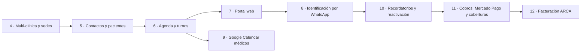

# LUCIA — Tu Recepcionista Oftalmológica Virtual con IA
## 05. Hoja de Ruta de Implementación (Roadmap & Milestones)

---

### Enfoque Spec-Driven Design (SDD)

1. Cada funcionalidad se especifica **antes** de implementarse: requisito en el PRD (spec 01), datos en la spec 03, integraciones y LUCIA en la spec 04, y su hito en este documento con alcance y criterios de aceptación.
2. Las specs son documentos vivos: se amplían a medida que el producto avanza. Un agregado indica qué partes ya construidas afecta y cómo se migran.
3. Cada hito se cierra cuando cumple sus criterios de aceptación, con pruebas E2E en `qa/e2e/` (`npm run test:e2e`) y casos en `qa/manual_tests.md`.

**Orden de prioridades:** primero toda la funcionalidad de operación (clínicas, pacientes, agenda, canales de reserva, recordatorios); **después todo lo referente a cobros** (Mercado Pago, coberturas y facturación).

### Estado de los Hitos

| Hito | Contenido | Estado |
| :--- | :--- | :--- |
| 1 | Estructura base, modelos y configuración inicial | Hecho |
| 2 | CRM y vistas por rol | Hecho |
| 3 | Agente LUCIA, conector WhatsApp y simulador | Hecho |
| 3.5 | Identidad visual (logo y paleta clínica) | Hecho |
| 4 | Multi-clínica (SaaS) y sedes | Hecho |
| 5 | Contactos y pacientes | Especificado — **próximo** |
| 6 | Agenda y turnos en el CRM | Especificado |
| 7 | Portal web de la clínica | Especificado |
| 8 | Identificación del paciente por WhatsApp | Especificado |
| 9 | Google Calendar de los médicos | Especificado |
| 10 | Recordatorios y reactivación | Especificado |
| 11 | Cobros: Mercado Pago y coberturas | Especificado |
| 12 | Facturación electrónica ARCA | Especificado |
| 13 | Historia clínica, recetas y reseñas | Postergado |

### Dependencias

El Hito 9 depende sólo del 6 y puede hacerse en paralelo con el 7 y el 8.

### Equivalencia con la numeración anterior

Los commits y documentos previos al 2026-10-17 usan otra numeración:

| Antes | Ahora |
| :--- | :--- |
| 3.6 | 4 |
| 3.7 | 5 (alta manual de pacientes) y 6 (agenda) |
| 3.8 | 5 (separación contacto/paciente) y 7 (portal web) |
| 3.9 | 8 |
| 3.10 | 9 |
| 4 | 11 |
| 5 | 12 |
| 6 | 10 |
| 7 | 13 |

---

### Desglose de Hitos de Implementación

#### Hito 1: Estructura Base, Modelos y Configuración Inicial
- Configuración del monorepo / proyecto Fullstack (Next.js 14+ App Router, TypeScript, Tailwind CSS, shadcn/ui).
- Inicialización de Prisma ORM con PostgreSQL.
- Scripts de migración y seed con datos oftalmológicos reales (Doctores, horarios de atención, obras sociales, consultorios).

#### Hito 2: CRM y Vistas de Rol (Secretaría, Médico, Marketing)
- **Vista Secretaría**: Tablero Kanban interactivo con drag-and-drop para mover pacientes entre fases del pipeline, inbox de chat de WhatsApp con botón de "Pausar / Reanudar LUCIA" para toma manual.
- **Vista Médico**: Agenda del día compacta, lista de pacientes asignados, motivo de consulta triagiado por la IA.
- **Vista Marketing**: Métricas de adquisición, atribución UTM (Meta Ads vs. Orgánico), tasa de conversión de agendamiento y facturación total.
- **Vista Admin**: Configuración de clínicas, médicos, aranceles y credenciales.

#### Hito 3: Agente Conversacional LUCIA & Conector WhatsApp
- Implementación de Webhook oficial para Meta WhatsApp Cloud API.
- **Simulador Interactivo de WhatsApp en el CRM**: Permite probar y validar en vivo los flujos de conversación de LUCIA (triage, preguntas frecuentes, selección de turnos) antes de conectar el número de WhatsApp de producción.
- Orquestador de Agente con LangChain / Vercel AI SDK y Tool Calling hacia el motor de turnos.

#### Hito 3.5: Identidad Visual del CRM (Logo y Paleta Clínica)
Objetivo: que el CRM se vea como un producto de salud profesional y confiable, con identidad propia de LUCIA, sin cambiar funcionalidad.

**Logo de LUCIA**
- Isotipo propio en SVG: un ojo estilizado cuyo iris sugiere una burbuja de chat (oftalmología + recepcionista por WhatsApp). Trazos simples, legible a 16 px.
- Variantes: logo completo (isotipo + "LUCIA"), isotipo solo (favicon, avatar de LUCIA en los chats) y monocromo blanco para fondos azules.
- Diseño original: no usa ni imita marcas de terceros (Meta/WhatsApp, Google, prepagas).
- Dónde va: pantalla de login, encabezado del menú lateral, favicon/ícono de la pestaña y avatar de los mensajes de LUCIA (Inbox y Simulador).

**Paleta clínica (azul, gris y blanco)** — definida como tokens de diseño (variables CSS de shadcn/ui en `globals.css`); ningún componente usa colores sueltos.

| Token | Color | Uso | Contraste vs. blanco |
| :--- | :--- | :--- | :--- |
| Primario | `#1D5FA6` (azul clínico) | Botones principales, enlaces, ítem activo del menú, barras del embudo | 6.48:1 |
| Primario hover | `#164C86` | Estado hover/presionado | 8.71:1 |
| Acento | `#3B82C4` (celeste) | **Sólo gráficos**: íconos, foco, detalles del logo (no texto) | 4.06:1 (≥ 3:1 para gráficos) |
| Azul tenue | `#E8F0FA` | Fondo del menú lateral, mensajes de LUCIA, columna activa del Kanban | — |
| Fondo suave | `#F3F6F9` (gris muy claro) | Fondo general de la app, columnas del Kanban | — |
| Superficie | `#FFFFFF` | Tarjetas, tablas, formularios, chat | — |
| Borde | `#D9E0E8` | Bordes y separadores | — |
| Texto | `#1F2A37` | Texto principal | 14.54:1 |
| Texto secundario | `#5B6675` | Etiquetas, ayudas, metadatos | 5.83:1 |
| Éxito | `#1E7A4C` | Confirmado, pago aprobado, "LUCIA activa" | 5.33:1 |
| Alerta | `#9A6200` | Reserva tentativa, pago pendiente | 5.10:1 |
| Peligro | `#B42318` | Urgencias, "Atención humana", cancelado, errores | 6.57:1 |

- Los estados (éxito, alerta, peligro) se usan sólo para estado, siempre con texto o ícono además del color.
- Tipografía: se mantiene Geist (sans) por legibilidad.
- Modo oscuro: fuera de alcance de este hito (el CRM se usa en recepción con modo claro).

**Alcance**
- Login con logo y fondo de marca; menú lateral con logo, azul tenue y estado activo en primario.
- Badges de estado de turnos, pagos, etapas del pipeline y urgencias según la tabla.
- Inbox y Simulador: mensajes de LUCIA en azul tenue con su avatar; mensajes de recepción en primario.
- Revisión visual de todas las pantallas (escritorio y celular) sin cambios de comportamiento.

**Criterios de aceptación**
1. El logo se ve en login, menú lateral, favicon y avatar de LUCIA, y es nítido de 16 px a 200 px.
2. Todo texto cumple WCAG AA (≥ 4.5:1) y los elementos gráficos ≥ 3:1.
3. No hay colores definidos fuera de los tokens (se verifica buscando hex sueltos en `src/`).
4. Las pruebas E2E y los casos de `qa/manual_tests.md` de los Hitos 1–3 siguen pasando sin cambios funcionales.

#### Hito 4: Multi-clínica (SaaS) y Sedes
Objetivo: poder vender LUCIA a varias clínicas, cada una aislada y con una o más sedes (PRD §4.7, spec 02 §4.4, spec 03 §4). Va primero porque cambia la autenticación y el modelo de agenda sobre el que se apoya todo lo demás.

**Alcance**
- **Panel de plataforma** (`PLATFORM_ADMIN`): listado de clínicas con métricas agregadas; alta de clínica (nombre, CUIT, slug, primera sede y primer Administrador con contraseña inicial); suspender y reactivar.
- **Usuarios de la clínica** (Administrador): alta, edición y desactivación de usuarios de todos los roles; contraseña inicial con cambio obligatorio en el primer ingreso; cambio de contraseña para todos los usuarios.
- **Ingreso**: email + contraseña con selección de clínica cuando coinciden varias cuentas; link de ingreso del equipo por clínica (`/c/<slug>/equipo`; `/c/<slug>` queda para la página pública del Hito 7); bloqueo de clínicas suspendidas.
- **Sedes**: ABM de sedes en Configuración; horarios de cada médico por sede y día, con consultorio; turnos con sede; filtro por sede en Agenda, Pipeline y Marketing.
- **LUCIA**: pregunta la sede, busca turnos por sede e informa la dirección de la sede del turno (spec 04 §1.3).
- **Migración** de los datos existentes a una sede inicial por clínica, y **seed** con dos clínicas (una con dos sedes) y un médico con cuenta en ambas.

**Criterios de aceptación**
1. Un usuario de la clínica A no ve ni modifica datos de la clínica B: probado por URL, por server action y desde el Simulador.
2. Un médico con cuentas en dos clínicas elige a cuál entrar y sólo ve los pacientes de esa clínica.
3. Una clínica suspendida no permite ingresar y LUCIA no responde por su WhatsApp.
4. LUCIA ofrece turnos de la sede elegida y nunca un horario de un médico en una sede donde ese día no atiende.
5. La plataforma no puede abrir pacientes, conversaciones ni historias clínicas de ninguna clínica.
6. Las pruebas de los Hitos 1 a 3.5 siguen pasando, adaptadas a sedes.

#### Hito 5: Contactos y Pacientes
Objetivo: separar a quien se comunica (contacto) de quien se atiende (paciente) y completar el registro de pacientes en el CRM (PRD §4.8, §4.10; spec 03 §5). Es un cambio estructural que conviene hacer antes de construir agenda, portal e identificación.

**Alcance**
- Modelos `Contact` y `ContactPatient`; conversaciones, pipeline y atribución de marketing pasan al contacto; turnos con `bookedByContactId`.
- Paciente con nombre, apellido, DNI, **sexo**, fecha de nacimiento, celular y email opcionales, obra social, plan y número de afiliado; DNI único por clínica; el celular deja de ser único.
- Alta y edición manual de pacientes desde la sección Pacientes (Secretaría y Administración).
- Migración: cada paciente actual genera su contacto con su celular, etapa y atribución, y sus conversaciones pasan al contacto. Pipeline, Inbox, Simulador y Marketing adaptados.

**Criterios de aceptación**
1. Pipeline, Inbox, Simulador y Marketing muestran los mismos datos que antes de la migración.
2. Un DNI no puede cargarse dos veces en la misma clínica; sí en clínicas distintas.
3. Un mismo contacto puede quedar asociado a varios pacientes (ej. un padre y sus hijos).
4. Un paciente dado de alta manualmente puede luego ser validado por WhatsApp o en la web con nombre, apellido, DNI y sexo.

#### Hito 6: Agenda y Turnos en el CRM
Objetivo: completar la operación diaria de recepción y de los médicos dentro del CRM (PRD §4.8).

**Alcance**
- Varias franjas horarias por día y por sede para cada médico, editables por el Administrador y por el propio médico, sin superposición.
- Vistas de agenda Día / Semana / Mes / Año con filtros por médico y sede; agenda para Secretaría sin motivo de consulta.
- Turnos manuales desde la agenda (crear, reprogramar, cancelar) con el servicio único de turnos (spec 04 §6.3) y `source = CRM`.
- **Regla transitoria hasta los hitos de cobro (11 y 12):** todo turno, sea de WhatsApp, web o CRM, queda **confirmado al reservarse** y se cobra en la clínica. LUCIA deja de pedir el pago y de retener el turno 15 minutos.

**Criterios de aceptación**
1. Un médico con franjas 9–13 y 15–19 el mismo día recibe ofertas de turno en ambas y nunca entre 13 y 15.
2. Las cuatro vistas muestran los mismos turnos para un mismo médico y período; un clic en un día de Mes o Año abre ese día.
3. Secretaría no ve el motivo de consulta en ninguna vista.
4. Un turno reservado por LUCIA queda confirmado sin pedir pago y deja de ofrecerse por todos los canales.

#### Hito 7: Portal Web de la Clínica
Objetivo: que cada clínica tenga su página pública donde se registran pacientes y se sacan turnos (PRD §4.9, §4.11).

**Alcance**
- Página `/c/<slug>` personalizable desde Configuración → Página web (logo, nombre, bienvenida, sedes, médicos, obras sociales, mostrar u ocultar precios, publicar).
- Ingreso del contacto con código **sólo por email**; registro de pacientes (uno mismo u otra persona) con nombre, apellido, DNI y sexo; edición de los pacientes que el contacto registró (salvo nombre, apellido, DNI y sexo); consulta, cancelación y reprogramación de los turnos que sacó.
- Reserva web para un paciente validado con sus cuatro datos, con preferencia de mañana o tarde, usando el servicio único de turnos (`source = WEB`).
- Email transaccional: bienvenida, código de verificación y avisos de turno con "Agregar a Google Calendar" y `.ics` (spec 04 §6.4).
- Seguridad del portal público (spec 02 §4.5).

**Criterios de aceptación**
1. Dos clínicas muestran cada una su logo, nombre y médicos; ninguna muestra datos de la otra.
2. Un DNI ya registrado no puede registrarse de nuevo; el aviso remite a recepción sin mostrar datos.
3. Sin el código de verificación correcto no se ven turnos ni datos; tras 5 intentos fallidos el código se bloquea.
4. Un contacto registra a dos hijos y saca un turno para cada uno; cada turno queda a nombre del hijo y asociado al contacto.
5. Un turno sacado en la web aparece en el CRM y deja de ofrecerse por WhatsApp; el contacto recibe el email con el botón de Google Calendar y el `.ics` válido.

#### Hito 8: Identificación del Paciente por WhatsApp
Objetivo: que LUCIA sólo reserve para pacientes registrados y validados, y que avise por email y WhatsApp (PRD §4.10, §4.11; spec 04 §6.1–6.2).

**Alcance**
- Herramienta `identify_patient` (nombre, apellido, DNI y sexo), reserva por `patientRef` y reglas nuevas del prompt; `check_availability` por mañana o tarde.
- Link de registro cuando los datos no coinciden con ningún paciente; al registrarse, email de bienvenida y mensaje de LUCIA para retomar la reserva.
- Notificación de turno reservado por email y por WhatsApp.
- Turnos para otras personas: un contacto valida y reserva para varios pacientes en la misma conversación.

**Criterios de aceptación**
1. Con datos que no coinciden con ningún paciente, LUCIA envía el link de registro y no reserva hasta completarlo; la respuesta es idéntica si el DNI existe con otros datos.
2. Un celular que cambió de dueño no accede a pacientes ni turnos sin los cuatro datos del paciente.
3. Un contacto saca turno para sí y para su hijo en la misma conversación, validando a cada uno.
4. Tras 3 validaciones fallidas en el día, LUCIA deriva a recepción.
5. Una consulta de información o una urgencia se atiende sin pedir identificación.
6. Elegida "tarde", ningún turno ofrecido empieza antes del corte de la clínica.

#### Hito 9: Google Calendar de los Médicos
Objetivo: que los turnos confirmados aparezcan en el Google Calendar de cada médico (PRD §4.12; spec 04 §6.5).

**Alcance**
- Conexión y desconexión de Google Calendar desde la agenda del médico; elección del calendario.
- Creación, actualización y eliminación de eventos al confirmar, reprogramar o cancelar.
- Manejo de tokens revocados con aviso al médico.
- Verificación de la app de OAuth ante Google (trámite que puede llevar semanas: iniciarlo apenas termine el Hito 6).

**Criterios de aceptación**
1. Confirmar, reprogramar y cancelar un turno se refleja en el calendario del médico en menos de un minuto.
2. El evento no contiene motivo de consulta ni datos clínicos.
3. Si el médico revoca el acceso, los turnos siguen funcionando en LUCIA y el médico ve el aviso para reconectar.

#### Hito 10: Recordatorios y Reactivación
Objetivo: reducir el ausentismo y recuperar consultas que quedaron a medias (PRD §4.2; spec 04 §2 y §5).

**Alcance**
- Plantillas de WhatsApp aprobadas por Meta para mensajes fuera de la ventana de 24 h (`recordatorio_turno_24h`, `reactivacion_lead_pendiente_24h`).
- Recordatorio 24 horas antes del turno, por WhatsApp y email, con botones para confirmar asistencia o pedir reprogramación.
- Reactivación del contacto que dejó una consulta sin reservar, a las 24 horas.
- Procesamiento diferido y en orden de los mensajes de un mismo contacto, en una cola (BullMQ o Inngest, spec 06).

**Criterios de aceptación**
1. Un turno confirmado recibe un único recordatorio 24 horas antes; si se cancela antes, no se envía.
2. La respuesta "Confirmar" o "Reprogramar" del paciente actualiza el turno y el pipeline.
3. Un contacto que vuelve a escribir antes de las 24 horas no recibe la reactivación.

#### Hito 11: Cobros — Mercado Pago y Coberturas
Objetivo: cobrar la consulta o la seña online según la cobertura del paciente (PRD §4.4, §4.4.1; spec 03 §3; spec 04 §3). Termina la regla transitoria del Hito 6.

**Alcance**
- Tabla de coberturas por obra social y plan: ABM en Configuración, herramienta `check_coverage` de LUCIA y monto del turno según la modalidad (sin cargo, copago, seña, particular, no atiende).
- Preferencia de pago con expiración de 15 minutos y retención del turno mientras tanto, en WhatsApp y en la web.
- Webhook de Mercado Pago con verificación de firma; confirmación automática del turno al acreditarse y aviso en el CRM.
- Cada clínica elige si exige pago previo o mantiene el cobro en la clínica.

**Criterios de aceptación**
1. Un paciente con cobertura `SIN_CARGO` reserva sin pagar; uno `PARTICULAR` recibe el link por el arancel del médico.
2. Un pago aprobado confirma el turno; si no se paga en 15 minutos, el turno se libera.
3. Una notificación de Mercado Pago con firma inválida se rechaza.

#### Hito 12: Facturación Electrónica ARCA (ex-AFIP WSFEv1)
- Conexión con el entorno de homologación de ARCA y posterior pase a producción.
- Caché del Ticket de Acceso (WSAA).
- Factura B o C con CAE, cálculo de importes y QR fiscal descargable, emitida automáticamente al acreditarse el pago.
- Pendiente de definir: si cada sede factura con su propio punto de venta.

#### Hito 13 (Opcionales, postergado): Historia Clínica Oftalmológica, Recetas y Reseñas
- Postergado por decisión del cliente: la carga de historia clínica no entra en los próximos hitos.
- Ficha clínica oftalmológica (agudeza visual OD/OI, PIO, biomicroscopía, fondo de ojo).
- Emisión de recetas en PDF.
- Solicitud automática de reseñas en Google Maps 3 horas después del turno completado.
